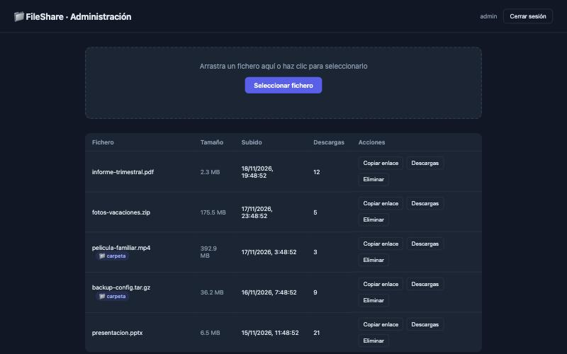

# FileShare — self-hosted file sharing with direct links

[Español](README.es.md)

A small, self-hosted service in a single Docker container. Upload files from a
password-protected admin panel and get a **direct, public download link** for
each one. Optional Telegram bot, watch folder and automatic HTTPS.

**Author:** Miguel González Oreiro ([github.com/mgoreiro](https://github.com/mgoreiro))



## Features

- **Admin panel** with login: upload, list, copy link, delete.
- **Direct download links** (`/d/<uuid>`), public, no login, keeping the original file name.
- **Download history** per file (date and IP of the last 200 downloads) and a download counter.
- **Watch folder:** drop a file in `data/watch/` and it is published automatically.
- **Telegram bot** (optional): download notifications and commands (`/status`, `/list`, `/delete`, `/subir`, `/listardescargas`).
- **Automatic HTTPS** with Let's Encrypt through the bundled Caddy variant.
- **No native dependencies** (bcryptjs, JSON storage): the image runs on amd64, arm64 and armv7 (Raspberry Pi, Apple Silicon, ARM servers).
- **Login hardening:** per-IP rate limiting, session regeneration, timing-safe comparisons, atomic database writes with automatic backup of a corrupt file.

## Quick start

1. Copy the environment file and edit it:

   ```bash
   cp .env.example .env
   ```

   At minimum set `ADMIN_USER`, `ADMIN_PASSWORD`, a long random `SESSION_SECRET`,
   and `BASE_URL` (the public URL used to build download links, e.g.
   `http://192.168.1.50:3000` or `https://files.example.com`).

2. Start it. The multi-arch image is published on Docker Hub as `mgoreiro/fileshare`:

   ```bash
   docker compose pull
   docker compose up -d
   ```

   To build from this source tree instead, use `docker compose up -d --build`.

3. Open `http://<your-host>:3000` and log in.

Data (JSON database and uploaded files) lives in `./data`, mounted as a volume,
so it survives restarts and upgrades.

## Updating

```bash
docker compose pull
docker compose up -d
```

(add `-f docker-compose.https.yml` for the HTTPS variant). `./data` is never
touched. If you build from source, run `docker compose down && docker compose up -d --build`
and compare your `.env` with `.env.example` for new variables.

## HTTPS with Let's Encrypt

`docker-compose.https.yml` puts [Caddy](https://caddyserver.com/) in front of
the app and obtains and renews a certificate automatically.

Requirements: a domain whose A/AAAA record points to your server, and ports 80
and 443 reachable from the Internet.

```dotenv
DOMAIN=files.example.com
ADMIN_USER=admin
ADMIN_PASSWORD=a_strong_password
SESSION_SECRET=a_long_random_string
```

```bash
docker compose -f docker-compose.https.yml up -d --build
docker compose -f docker-compose.https.yml logs -f caddy   # watch the certificate being issued
```

In this variant the app no longer publishes port 3000; all traffic goes through
Caddy. Certificates are stored in the `caddy_data` volume. `BASE_URL`,
`COOKIE_SECURE` and `TRUST_PROXY` are set for you.

The optional [caddy-tui](https://github.com/mgoreiro/caddy-tui) terminal tool
can manage this Caddy (validated edits, diagnostics, certificate expiry,
Telegram alerts, scanner blocking). It is a separate program and is not needed
to run FileShare.

## Building for ARM

Building on the ARM device itself (`docker compose up -d --build`) gives a
native image. To build elsewhere:

```bash
docker buildx create --use
docker buildx build \
  --platform linux/amd64,linux/arm64,linux/arm/v7 \
  -t your-user/fileshare:latest --push .
```

## Watch folder

Any file placed in `data/watch/` is registered automatically with its own
direct link, as if uploaded from the panel (it shows a "📁 folder" tag). It is
then **moved** to `data/uploads/`.

- Hidden files and in-progress extensions (`.tmp`, `.part`, `.partial`, `.crdownload`, `.download`) are ignored.
- Before processing, the service waits until the file size stops changing (a stricter check for files of 100 MB or more).
- The recorded size of every file is compared with the real size on disk at startup and then every hour (`SIZE_CHECK_INTERVAL_MINUTES`, `0` = startup only).
- Files dropped while the container is stopped are processed on the next start.

Disable it with `WATCH_ENABLED=false`.

> **Security note:** anyone with write access to `./data/watch` (SSH, Samba,
> shared USB…) can publish files without logging in to the panel. Treat that
> folder with the same trust as the admin credentials.

## Telegram bot

Set `TELEGRAM_BOT_TOKEN` and `TELEGRAM_CHAT_ID` to receive a notification for
every download (file, size, source IP, date) and to manage the service from
the chat. It uses long polling, so no webhook or extra endpoint is needed and
no extra dependency is added.

1. Talk to **@BotFather**, send `/newbot` and keep the token.
2. Send any message to your new bot, then open
   `https://api.telegram.org/bot<TOKEN>/getUpdates` and read `"chat":{"id":...}`.
3. Put both values in `.env` and run `docker compose up -d --build`.

| Command | What it does |
|---|---|
| `/status` | Uptime, number of files, space used, total downloads, memory. |
| `/list` | All files with size and download count. |
| `/delete` | Button menu to choose a file to delete. |
| `/subir` | The bot asks for a file (send it as a document) and replies with its direct link. |
| `/listardescargas` | Pick a file and get its download history. |

Only the configured chat (plus any in `TELEGRAM_ALLOWED_CHAT_IDS`, comma
separated) can use commands; everything else is ignored. If the variables are
empty the whole feature is off and no network calls are made. Telegram
failures never affect downloads.

## Environment variables

| Variable | Description | Default |
|---|---|---|
| `PORT` | Internal container port | `3000` |
| `ADMIN_USER` | Admin user (only applied if none exists yet) | — |
| `ADMIN_PASSWORD` | Admin password (stored as a bcrypt hash) | — |
| `SESSION_SECRET` | Secret used to sign session cookies | random if unset |
| `BASE_URL` | Public URL used to build `/d/:id` links | `http://localhost:3000` |
| `MAX_FILE_SIZE_MB` | Maximum upload size in MB (0 = unlimited) | `500` |
| `WATCH_ENABLED` | Enable the `data/watch/` folder | `true` |
| `SIZE_CHECK_INTERVAL_MINUTES` | Background size-consistency check interval (0 = startup only) | `60` |
| `TELEGRAM_BOT_TOKEN` | Telegram bot token | — (disabled) |
| `TELEGRAM_CHAT_ID` | Chat that receives notifications and may use commands | — (disabled) |
| `TELEGRAM_ALLOWED_CHAT_IDS` | Extra chat IDs allowed to use commands | `TELEGRAM_CHAT_ID` |
| `RESET_ADMIN` | Regenerate the admin user/password at startup | `false` |
| `TRUST_PROXY` | Trusted proxies for `X-Forwarded-For`. `false` if you publish port 3000 directly, `1` behind Caddy/nginx (the HTTPS compose sets it) | `false` in `docker-compose.yml` |
| `LOGIN_MAX_ATTEMPTS` / `LOGIN_WINDOW_MINUTES` | Failed logins allowed per IP, and lock-out minutes (0 = no limit) | `10` / `15` |

The admin account is created only the **first time** the container starts
(when `data/db.json` does not exist yet). To change it later, set
`RESET_ADMIN=true`, restart once, and set it back to `false`.

If you run your own reverse proxy (nginx, Traefik…) with the plain
`docker-compose.yml`, set `TRUST_PROXY=1`; otherwise the download history and
the login limiter will see the proxy's IP.

## How the direct link works

Each upload gets a UUID and a link like `https://your-host/d/<id>`. It is
public (no login) and serves the file with its original name. The panel counts
downloads per file.

## Security notes

- **Use HTTPS** if you expose it to the Internet (the Caddy variant does this for you).
- Sessions live in memory (`MemoryStore`): fine for a single container, but users must log in again after a restart and it does not scale to several replicas.
- Download links are "possession of the link" (like an unlisted link): anyone who has it can download the file.
- Change the default `ADMIN_PASSWORD` and `SESSION_SECRET`; the server warns at startup if you did not.

## Local development (no Docker)

```bash
npm install
cp .env.example .env
node server.js
```

## License

MIT — see [LICENSE](LICENSE).

## Author

**Miguel González Oreiro** · [github.com/mgoreiro](https://github.com/mgoreiro) · [hub.docker.com/r/mgoreiro/fileshare](https://hub.docker.com/r/mgoreiro/fileshare)
